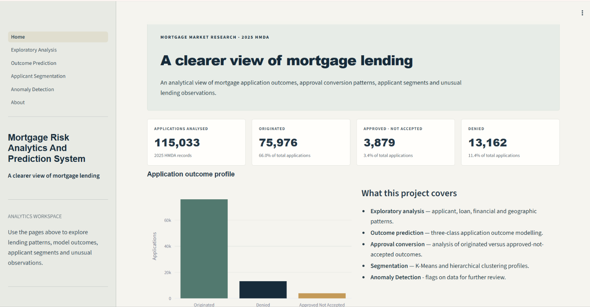
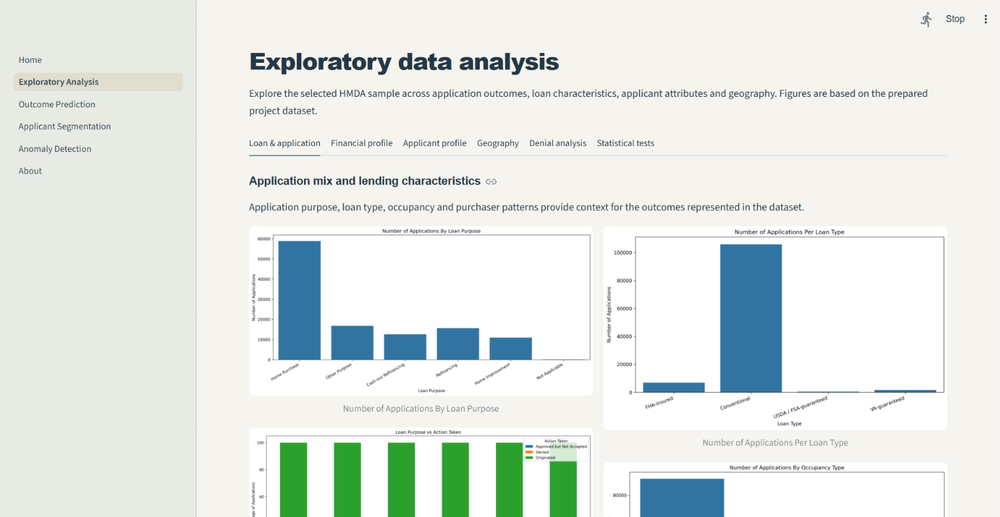
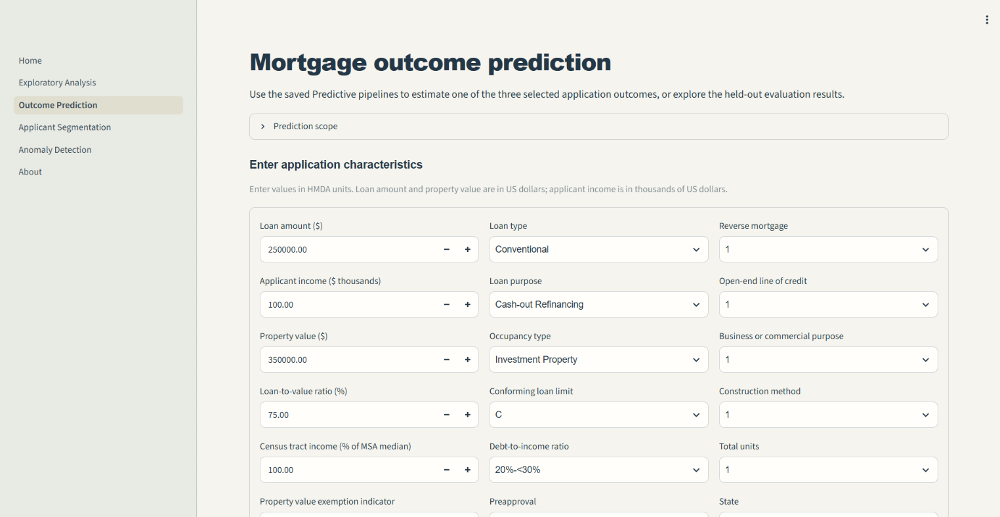
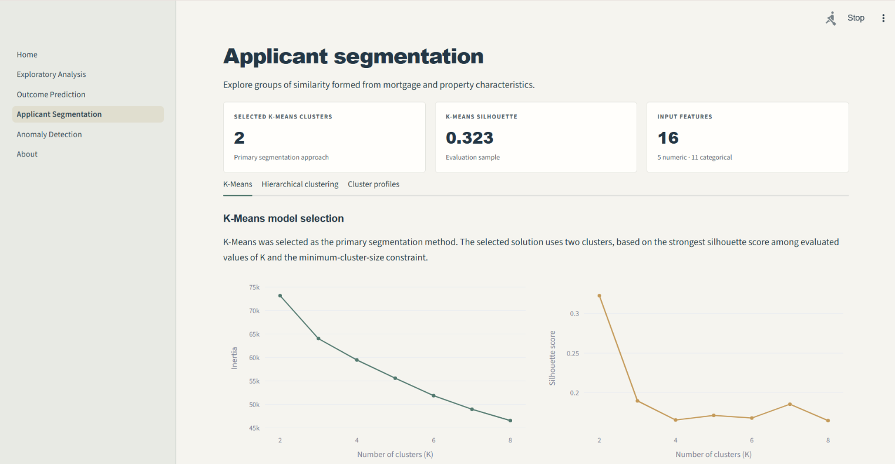
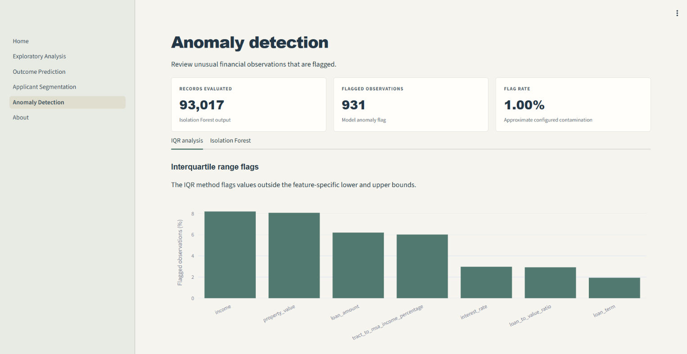

# Mortgage Risk Analytics & Prediction System

An end-to-end **Data Analytics** and **Machine Learning project** focused on understanding **mortgage lending patterns**, **analysing loan application outcomes**, identifying **applicant segments**, and **predicting mortgage decisions**.

Mortgage lending institutions process large volumes of applications involving different applicant profiles, financial characteristics, property values, and loan conditions. Analysing these factors helps identify lending patterns, understand approval outcomes, and support data-driven decision-making.

This project uses the 2025 Home Mortgage Disclosure Act (HMDA) dataset to develop an **integrated risk analytics and prediction system**.

It combines exploratory data analysis, statistical analysis, machine learning, clustering, and an interactive dashboard to examine mortgage lending behaviour.

---

## Application Overview

**Live Application:** [Mortgage Risk Analytics and Prediction System Dashboard](https://mortgage-risk-analytics-and-prediction.onrender.com)

The interactive Streamlit application provides a centralized interface to explore mortgage lending data, analyse application outcomes, evaluate predictive models, understand applicant segments, and investigate potential anomalies.

## Application Screenshots

### Home Dashboard


### Exploratory Data Analysis


### Outcome Prediction


### Applicant Segmentation


### Anomaly Detection


---

## Project Objectives

- Analyse mortgage application patterns across applicant, loan, property, and geographic characteristics.
- Identify factors and relationships associated with mortgage application outcomes.
- Develop machine learning models to predict mortgage application decisions.
- Analyse loan conversion patterns among approved applications.
- Segment applicants based on their financial and loan characteristics.
- Identify potentially unusual mortgage applications using anomaly detection.
- Present analytical findings and model results through an interactive dashboard.

---

## Project Outcomes

| Analysis / Component | Work Performed | Algorithms / Models | Outcome |
|---|---|---|---|
| Data Preprocessing | Cleaned the HMDA dataset, handled missing values, removed duplicates, and prepared analytical features. | Pandas, NumPy | Created a structured and analysis-ready dataset containing 115,033 mortgage application records. |
| Exploratory Data Analysis | Examined applicant demographics, loan characteristics, property values, lending patterns, and geographic distributions. | Matplotlib, Seaborn, Plotly | Identified key trends, distributions, and relationships across mortgage applications. |
| Statistical Analysis | Performed hypothesis testing, descriptive analysis, and comparisons across mortgage application outcomes. | Chi-Square Test, Welch's t-test, Mann-Whitney U Test, Welch's ANOVA, Benjamini-Hochberg FDR Correction | Evaluated statistically significant associations and differences across applicant and loan characteristics. |
| Mortgage Outcome Prediction | Developed multi-class classification models to predict mortgage application outcomes: Originated, Approved Not Accepted, and Denied. | Logistic Regression, Random Forest, LightGBM | Compared classification performance and class-weighting strategies to address class imbalance. |
| Loan Conversion Analysis | Analysed historical conversion among approved applications by distinguishing originated applications from approved but not accepted applications. | Random Forest, LightGBM | Developed a separate binary classification approach for loan conversion analysis. |
| Applicant Segmentation | Grouped applicants based on financial, property, and loan characteristics and evaluated cluster quality. | K-Means Clustering, Agglomerative Hierarchical Clustering | Identified distinct mortgage applicant segments with different financial and lending profiles. |
| Anomaly Detection | Examined application records for unusual patterns across selected financial and loan characteristics. | Isolation Forest | Identified potentially atypical mortgage applications for further investigation. |
| Interactive Dashboard | Integrated analytical findings, predictive capabilities, clustering insights, and anomaly detection into a multi-page application. | Streamlit, Plotly | Developed an interactive dashboard for exploring mortgage lending patterns and analytical results.

---

### Dataset Summary

- **Data Source:** [2025 HMDA Loan Application Register (CFPB)](https://ffiec.cfpb.gov/data-publication/modified-lar)
- **Dataset:** Home Mortgage Disclosure Act (HMDA), 2025 (Applications from selected mortgage lending institutions)
- **Processed Records:** 115,033.
- **Primary Prediction Target:** Mortgage application outcome (`action_taken`).
- **Prediction Classes:**
  - Originated
  - Approved Not Accepted
  - Denied

---

## Project Architecture

The project follows a modular structure, separating data preparation, analytics, machine learning, results, and application development.

```text
Mortgage_Risk_Analytics_and_Prediction_System/
│
├── Analytics/
│   ├── 01_preprocessing.py
│   ├── 02_eda.py
│   └── 03_statistical_analysis.py
│
├── ML/
│   ├── 04_data_preparation.py
│   ├── 05_prediction_ml.py
│   └── 06_clustering.py
│
├── Dataset/
│   ├── Raw/
│   └── Processed/
│
├── Results/
│   ├── Prepared_Datasets/
│   ├── EDA_Graphs/
│   ├── Statistical_Analysis/
│   └── ML/
│       ├── Prediction_Results/
│       └── Clustering_Results/
│
├── Report/
│   ├── EDA_Results.md
│   ├── Statistical_Analysis_Results.md
│   ├── Predictive_Model_Results.md
│   ├── Clustering_and_Segmentation_Results.md
│
├── assets/
│   └── style.css
│
├── .streamlit/
│   └── config.toml
│
├── Home.py
├── utils.py
├── requirements.txt
└── README.md
```

---

### Analytical Workflow

```text
             HMDA 2025 Dataset
                     |
                     v
              Data Preprocessing
                     |
                     v
        Exploratory Data Analysis (EDA)
                     |
                     v
             Statistical Analysis
                     |
                     v
                 Anomaly Detection
                      |
                      v       
        Machine Learning Preparation
                     |
          +----------+----------+
          |                     |
          v                     v
   Predictive Modelling     Clustering
          |                     |
          v                     v
   Loan Outcome Prediction  Applicant Segmentation
          |                     |
          v                     |
   Loan Conversion Analysis     |
          |                     |
          +----------+----------+
                     |
                     v
        Interactive Streamlit Dashboard
```
---

## Reports & Results

Detailed analytical, visualisations, model evaluation results, clustering outputs, interpretation reports are available in the repository.

**[View Obtained Results](Results/)**

**[View Interpretation Reports](Report/)**

The results and reports cover:

- **Exploratory Data Analysis:** Applicant characteristics, loan distributions, lending patterns, geographic analysis, and visualisations.
- **Statistical Analysis and Anomaly Detection:** Descriptive statistics, hypothesis testing, group comparisons, and statistical significance. Isolation Forest results and identification of potentially unusual application profiles.
- **Predictive Modelling:** Logistic Regression, Random Forest, and LightGBM model comparisons, evaluation metrics, confusion matrices, and results for mortgage outcome and loan conversion prediction.
- **Clustering:** K-Means and Agglomerative Hierarchical Clustering results, cluster evaluation, and applicant segment profiles.

---

## Tech Stack & Tools

| Category | Technologies |
|---|---|
| Programming Language | Python |
| Data Manipulation | Pandas, NumPy |
| Data Visualisation | Matplotlib, Seaborn, Plotly |
| Statistical Analysis | SciPy, Statsmodels |
| Machine Learning | Scikit-learn, LightGBM |
| Dashboard Development | Streamlit |
| Data Source | HMDA 2025 |
| Version Control | Git, GitHub |

---

## How to Run the Project

### 1. Clone the Repository

```bash
git clone https://github.com/Artemis231005/Mortgage-Risk-Analytics-Prediction-System
```

### 2. Navigate to the Project Directory

```bash
cd Mortgage_Risk_Analytics_and_Prediction_System
```

### 3. Create a Virtual Environment

```bash
python -m venv venv
```

Activate the environment:

**Windows:**

```bash
venv\Scripts\activate
```

**macOS / Linux:**

```bash
source venv/bin/activate
```

### 4. Install Dependencies

```bash
pip install -r requirements.txt
```

### 5. Run the Streamlit Application

```bash
streamlit run Home.py
```

---
